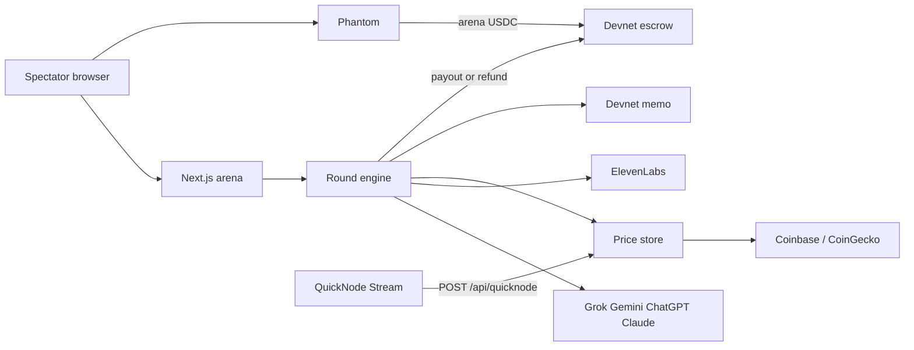
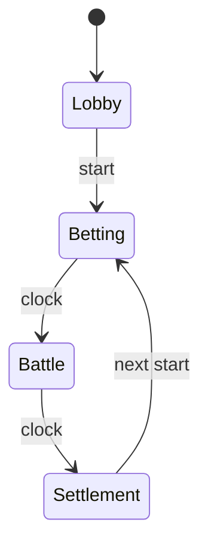

# Architecture

Bot Royale is a single Next.js process. The browser is a broadcast. The round engine is a clock in that process. Solana devnet is the ledger for memos, bets, and payouts. The SOL price is market data, not a devnet account.

## Diagram

## Round state

One round at a time, stored on `globalThis` so route handlers share it. Lobby is the absence of a round.

Battle ticks do not overlap. A slow model call delays the next tick instead of stacking a second one. Invalid decisions become PASS. A dev-server reload bumps a generation counter so an old timer cannot fire twice.

The roster freezes when a round starts. Player-made agents live on `globalThis` until the process restarts. Each agent stores a provider (`grok`, `gemini`, `openai`, `anthropic`) and a server-side prompt. The public desk route does not return the prompt.

The open is the first battle price. On a short round it is the tape anchor. The result is YES when the close is more than 0.05% above the open, NO when it is more than 0.05% below, otherwise a push. The agent's last side is the side its backers hold.

## Price

`PRICE_SOURCE=fallback` polls Coinbase and falls back to CoinGecko. `PRICE_SOURCE=quicknode` prefers a price posted to `/api/quicknode` for `QUICKNODE_MAX_AGE_MS`, then uses the public feed. The webhook accepts a normalized body `{ "price": number, "observedAt": string }` and checks `QUICKNODE_WEBHOOK_SECRET` when it is set. Bets and memos never follow that stream onto mainnet.

A short round anchors on the first live price, then follows a fixed tape: rally, crash below half, and a finish above the open, so the scripted result is YES. The chart labels that path **Demo tape**.

## Agents and commentary

Degen and Grok Analyst call xAI. Grandma calls Gemini. Contrarian calls ChatGPT. A player-made agent calls whichever of those four, plus Claude, was selected. The commentator still calls xAI for one sentence, then ElevenLabs when `ELEVENLABS_VOICE_COMMENTATOR` is set. Each notable moment produces at most one line: a fresh YES or NO, then a flip, plus the phase changes. The booth keeps a single in-flight line. The browser plays one clip at a time and shows the text if audio cannot start.

On a short round, a default agent whose model never answered plays a scripted YES, NO, or PASS. A real model decision is kept. A custom agent with no key passes and is not scripted.

## Devnet money

`scripts/setup-devnet.ts` creates six keypairs (escrow, four agents, one spectator) and a 6-decimal SPL mint. The spectator receives 10,000 arena tokens so a presenter can stake without a faucet for the token. Default agent wallets pay the fee on their own memo transactions. A player-made agent has no keypair, so the escrow key signs that memo. The escrow wallet pays the fee on payouts.

A stake is one transaction with three instructions: create the escrow token account if needed, transfer arena tokens to it, and attach a memo `Bot Royale bet <agent>`. `POST /api/bet` loads the confirmed transaction, checks the mint, the escrow balance increase, the memo, and that the signature has not been used. The agent id in the memo must be on the round. A memo for some other id is refunded.

At settlement the engine plans transfers in base units:

- Backers of a correct agent split the YES+NO pool by their stake. The house fee is 0. That transfer is the stake plus that backer's share of the agent's profit. Three stakes of 50, 25, and 25 on an agent that profits 100 pay 100, 50, and 50.
- PASS stakes are refunded and are not in the pool. A push refunds everyone. If the winning side has no stake, everyone is refunded.
- Integer dust is added to the last payout so the active pool is fully assigned.

There is no on-chain program. Trust for the demo sits with the escrow key, which never leaves `.env.local`.

## Process

Run `next dev` or `next start` on the demo laptop. The tick is a `setTimeout` in that process. A tunnel is only needed when a QuickNode Stream must reach `/api/quicknode`.

Public addresses from the local setup (devnet):

| Role | Address |
| --- | --- |
| Escrow | `4iBXdNbszemi28gwiuKfxv3UPvbc1H4YjDuwHrp3tgCf` |
| Degen | `4SW6eF4QBeXLJSQWAfAv3pfPZ3JaRC7e9jjaJMQxFxiN` |
| Grandma | `CQkYBoBT9JJ2SwSmJTDBFKHwYoy3bwCCQLQhMTvhh93H` |
| Contrarian | `H6ALY9BjpoYc8A5bRPSYwh1BaJuEDMAxxVsyrmreruw1` |
| Grok Analyst | `BJaAYrCVHKnVB7u15otDVPA3EzZJ5KcLEVb59p4m5yeh` |
| Spectator | `46VpLx1qf6fDau5XwqNaEYJFf1itDH2XS3fSSJX1R9jV` |

The mint is created on the next `npm run setup:devnet` after the escrow has devnet SOL. The public RPC airdrop endpoint is closed, so that SOL comes from [https://faucet.solana.com](https://faucet.solana.com). Explorer links use `?cluster=devnet`.
